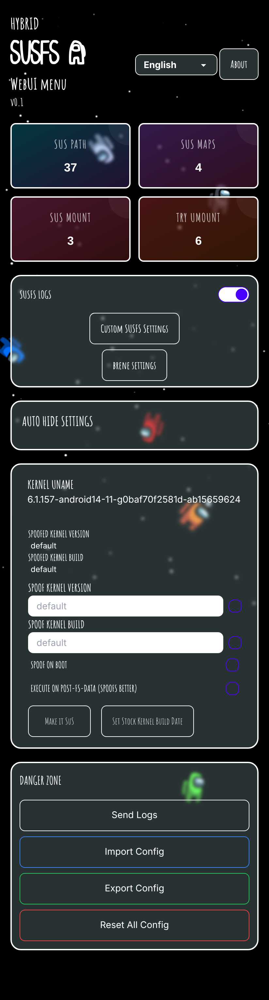
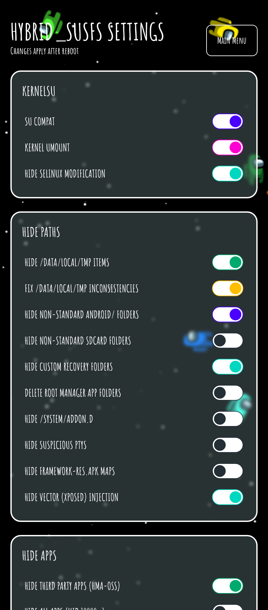

<h1 align="center">hybrid_susfs · SUSFS module for KernelSU</h1>

  KernelSU &nbsp;·&nbsp; SUSFS v2 &nbsp;·&nbsp; arm64 &nbsp;·&nbsp; WebUI

  <a href="README.md"> Bahasa Indonesia</a> &nbsp;·&nbsp; <b> English</b>

  <a href="https://github.com/cogan17/hybrid_SusFS/releases"><b>⬇️ Download</b></a>
  &nbsp;·&nbsp;
  <a href="#-install"><b>📖 Guide</b></a>
  &nbsp;·&nbsp;
  <a href="CHANGELOG.md"><b>📝 Release notes</b></a>
  &nbsp;·&nbsp;
  <a href="https://github.com/cogan17/Cogan-Kernel"><b>🐧 Cogan Kernel</b></a>
  &nbsp;·&nbsp;
  <a href="https://t.me/coganTWRP"><b>💬 Telegram community</b></a>

> [!WARNING]
> The maintainer/developer is not responsible for bootloops or bricks. Device owners are responsible for their own devices! Back up your data.

> [!TIP]
> **Sister repository:** hybrid_susfs is made for [Cogan Kernel](https://github.com/cogan17/Cogan-Kernel) (Xiaomi 14T Pro), which already ships SUSFS in the kernel. The module also works on other kernels patched with SUSFS v2.

---

  
  &nbsp;
  

### 📥 Install

1. Make sure the kernel has **SUSFS v2** and root is **KernelSU** (arm64). Otherwise the install stops with a clear message.
2. Download `hybrid_susfs_vX.Y.zip` from [Releases](https://github.com/cogan17/hybrid_SusFS/releases).
3. Install it in the KernelSU manager, then reboot.
4. Open the module's WebUI to configure it. Later updates appear as an update button in the manager.

|   |   |
|---|---|
| 🔄 **Switching from another SUSFS module** | `susfs4ksu` (sidex15), `brene` and `susfs_manager` are disabled on install, so no rule is applied twice |
| 🗑️ **Uninstall** | Remove it in the manager, then reboot. The previous `ksu_susfs` is only restored to empty paths (never over another module's) |
| 🩺 **Problems & logs** | The **Send Logs** button in the WebUI. Logs include the build identity (`MANIFEST.txt`) so they can be matched to the ZIP |

---

✨ <b>What's inside</b>

It combines three sources:

| Part | Source |
|---|---|
| Engine (`ksu_susfs`) | [simonpunk/susfs4ksu](https://gitlab.com/simonpunk/susfs4ksu), compiled from source at build time |
| UI (WebUI) and base scripts | [sidex15/susfs4ksu-module](https://github.com/sidex15/susfs4ksu-module) |
| Extra features (*hybrid_susfs settings* page) | [rrr333nnn333/BRENE](https://github.com/rrr333nnn333/BRENE) |

- ✅ Features found in both SideX and Brene use the SideX version, so no rule is applied twice: uname spoof, AVC log spoofing, hide sus mounts, cmdline spoof, SUSFS log, custom ROM hiding and the custom lists.
- ✅ The SideX and Brene system property spoofing is merged into one toggle on the *hybrid_susfs settings* page.
- ✅ UID filter companion for HMA-OSS: **Refresh UID filter** and **Check UID** buttons.
- ✅ The binary is not downloaded from the cloud. The module uses the binary shipped in the ZIP.
- ✅ Transactional install/update: on failure the previous state is restored and verified.
- ✅ Config is read as data with a per-setting schema, never run as a script. Stored in `/data/adb/hybrid_susfs/config.sh`.

🔄 <b>Update system</b>

| Part | How it updates |
|---|---|
| simonpunk engine | Automatic on every build: always the latest branch in `upstream.env`. The build stops if a `ksu_susfs` command used by the module is gone (`tools/check_engine.sh`). |
| SideX UI and Brene features | Manual. The commits in use are recorded in `upstream.env`. **Cek pembaruan** lists new commits and changed files without changing anything. Useful changes are picked one by one. |
| To users | `updateJson` in `module.prop` → `update.json` → GitHub release. The KernelSU manager shows an update button. |

**Versions:** 0.1, 0.2, 0.3 and so on (`versionCode` 1, 2, 3, ...), bumped with every fix.

🛠️ <b>Build & Actions</b>

**Local build:** `NDK=/path/android-ndk ./build.sh`. Output goes to `out/`.

**Releasing a new version:** bump `version`/`versionCode` in `module/module.prop` and `update.json`, add a `## vX.Y` section to `CHANGELOG.md`, merge into `Utama`, run **hybrid_susfs Builder** (CI), test the artifact ZIP on the phone, then publish that run with **Rilis dari run**. The build stops if these three do not match.

| Workflow | Purpose |
|---|---|
| hybrid_susfs Builder | Builds from `Utama`. CI = artifact only; Pre-Release/Release = publishes right away. |
| Rilis dari run | Publishes the ZIP of a green Builder run, exactly the one tested (digest checked). Notes in ID/EN, a **tested on the phone** tick, and **replace**. |
| Validate | Automatic on every PR to `Utama`: shellcheck, syntax, versions, YAML, WebUI, engine gate. |
| Cek pembaruan | Check only: new SideX and Brene commits, and whether the latest simonpunk SUSFS passes the engine gate. |
| Hapus log run lama | Check only by default; type `HAPUS` to delete old runs. |

🧪 <b>Test status</b>

| Build | Result |
|---|---|
| `v0.4` (SUSFS v2.4.0 · Cogan Kernel · Xiaomi 14T Pro) | ✅ Tested on the phone 17 Nov 2026: release ZIP installed, Duck Detector Danger 0 · Warning 0 · Ready 20 |

Full history: [Release notes](CHANGELOG.md).

---

  Maintainer <b>Cogan17</b> &nbsp;·&nbsp; engine <b>simonpunk</b> &nbsp;·&nbsp; UI <b>sidex15</b> &nbsp;·&nbsp; features <b>rrr333nnn333</b>
   AGPL-3.0 license, following SideX and Brene · <code>ksu_susfs</code> from simonpunk (GPL-3.0)

Sister repositories: [cogan17/Cogan-Kernel](https://github.com/cogan17/Cogan-Kernel) · [cogan17/CoganSU](https://github.com/cogan17/CoganSU) · [cogan17/TWRP-14T-PRO](https://github.com/cogan17/TWRP-14T-PRO)
