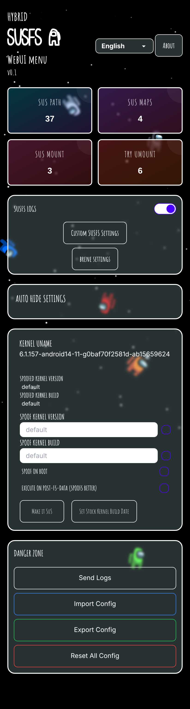
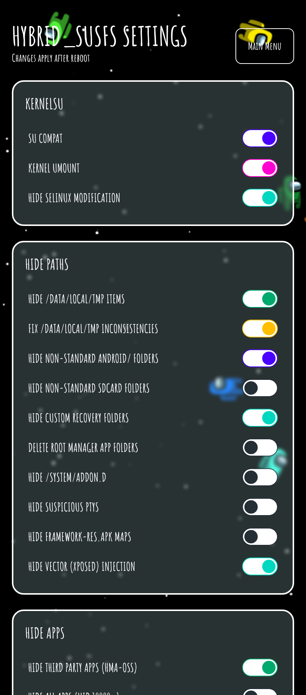

<h1 align="center">hybrid_susfs · Modul SUSFS untuk KernelSU</h1>

  KernelSU &nbsp;·&nbsp; SUSFS v2 &nbsp;·&nbsp; arm64 &nbsp;·&nbsp; WebUI

  <b> Bahasa Indonesia</b> &nbsp;·&nbsp; <a href="README.en.md"> English</a>

  <a href="https://github.com/cogan17/hybrid_SusFS/releases"><b>⬇️ Unduh Modul</b></a>
  &nbsp;·&nbsp;
  <a href="#-pasang"><b>📖 Panduan</b></a>
  &nbsp;·&nbsp;
  <a href="CHANGELOG.md"><b>📝 Catatan Rilis</b></a>
  &nbsp;·&nbsp;
  <a href="https://github.com/cogan17/Cogan-Kernel"><b>🐧 Cogan Kernel</b></a>
  &nbsp;·&nbsp;
  <a href="https://t.me/coganTWRP"><b>💬 Komunitas Telegram</b></a>

> [!WARNING]
> Jika terjadi bootloop atau brick, bukan tanggung jawab maintainer/developer. Pemilik device bertanggung jawab atas devicenya sendiri! Harap cadangkan datamu.

> [!TIP]
> **Repository bersaudara:** hybrid_susfs dibuat untuk [Cogan Kernel](https://github.com/cogan17/Cogan-Kernel) (Xiaomi 14T Pro), yang sudah membawa SUSFS di dalam kernel. Modul ini tetap bisa dipakai di kernel lain yang sudah di-patch SUSFS v2.

---

  
  &nbsp;
  

### 📥 Pasang

1. Pastikan kernel sudah punya **SUSFS v2** dan root memakai **KernelSU** (arm64). Tanpa itu, pemasangan dihentikan dengan pesan yang jelas.
2. Unduh `hybrid_susfs_vX.Y.zip` dari [Rilis](https://github.com/cogan17/hybrid_SusFS/releases).
3. Pasang lewat manager KernelSU, lalu reboot.
4. Buka WebUI modul untuk mengatur. Pembaruan berikutnya muncul sebagai tombol update di manager.

|   |   |
|---|---|
| 🔄 **Ganti dari modul SUSFS lain** | `susfs4ksu` (sidex15), `brene` dan `susfs_manager` dimatikan otomatis saat pemasangan, supaya tidak ada aturan ganda |
| 🗑️ **Uninstall** | Hapus dari manager lalu reboot. `ksu_susfs` lama dikembalikan hanya ke path yang kosong (tidak menimpa milik modul lain) |
| 🩺 **Masalah & log** | Tombol **Send Logs** di WebUI. Log memuat identitas build (`MANIFEST.txt`) supaya bisa dicocokkan dengan ZIP |

---

✨ <b>Isi modul</b>

Perpaduan tiga sumber:

| Bagian | Sumber |
|---|---|
| Mesin (`ksu_susfs`) | [simonpunk/susfs4ksu](https://gitlab.com/simonpunk/susfs4ksu), di-compile dari source saat build |
| Tampilan (WebUI) dan skrip dasar | [sidex15/susfs4ksu-module](https://github.com/sidex15/susfs4ksu-module) |
| Fitur tambahan (halaman *hybrid_susfs settings*) | [rrr333nnn333/BRENE](https://github.com/rrr333nnn333/BRENE) |

- ✅ Fitur yang ada di SideX dan Brene sekaligus memakai versi SideX, supaya tidak ada aturan ganda: spoof uname, AVC log spoofing, hide sus mounts, spoof cmdline, log SUSFS, hide custom ROM, dan daftar custom.
- ✅ Spoof system properties SideX dan Brene digabung jadi satu toggle di halaman *hybrid_susfs settings*.
- ✅ Filter UID pendamping HMA-OSS: tombol **Perbarui filter UID** dan **Cek UID**.
- ✅ Binary tidak diunduh dari cloud. Yang dipakai adalah binary yang dibawa ZIP.
- ✅ Install/update transaksional: bila gagal, keadaan sebelumnya dikembalikan dan diverifikasi.
- ✅ Config dibaca sebagai data dengan skema per pengaturan, tidak dijalankan sebagai skrip. Disimpan di `/data/adb/hybrid_susfs/config.sh`.

🔄 <b>Sistem update</b>

| Bagian | Cara update |
|---|---|
| Mesin simonpunk | Otomatis setiap build: selalu cabang terbaru di `upstream.env`. Build berhenti bila perintah `ksu_susfs` yang dipakai modul hilang (`tools/check_engine.sh`). |
| Tampilan SideX dan fitur Brene | Manual. Commit yang dipakai dicatat di `upstream.env`. **Cek pembaruan** menampilkan commit baru dan file yang berubah, tanpa mengubah apa pun. Perubahan yang berguna diambil satu per satu. |
| Ke pengguna | `updateJson` di `module.prop` → `update.json` → rilis GitHub. Manager KernelSU menampilkan tombol update. |

**Versi:** 0.1, 0.2, 0.3, dan seterusnya (`versionCode` 1, 2, 3, ...), naik setiap ada perbaikan.

🛠️ <b>Build & Actions</b>

**Build lokal:** `NDK=/path/android-ndk ./build.sh`. Hasilnya ada di `out/`.

**Langkah rilis versi baru:** naikkan `version`/`versionCode` di `module/module.prop` dan `update.json`, tambah bagian `## vX.Y` di `CHANGELOG.md`, gabung ke `Utama`, jalankan **hybrid_susfs Builder** (CI), uji ZIP dari artifact di HP, lalu terbitkan run itu dengan **Rilis dari run**. Build berhenti bila ketiganya tidak sama.

| Workflow | Fungsi |
|---|---|
| hybrid_susfs Builder | Build dari `Utama`. CI = artifact saja; Pre-Release/Release = langsung terbit. |
| Rilis dari run | Menerbitkan ZIP dari run Builder yang hijau, sama persis dengan yang diuji (digest dicek). Ada catatan ID/EN, centang **diuji di HP**, dan **timpa**. |
| Validate | Otomatis di setiap PR ke `Utama`: shellcheck, sintaks, versi, YAML, WebUI, gate mesin. |
| Cek pembaruan | Hanya cek: commit baru SideX dan Brene, dan apakah SUSFS simonpunk terbaru lolos gate mesin. |
| Hapus log run lama | Cek saja secara bawaan; ketik `HAPUS` untuk menghapus run lama. |

🧪 <b>Status uji</b>

| Build | Hasil |
|---|---|
| `v0.4` (SUSFS v2.4.0 · Cogan Kernel · Xiaomi 14T Pro) | ✅ Diuji di HP 17 Nov 2026: ZIP dari rilis dipasang di HP, Duck Detector Danger 0 · Warning 0 · Ready 20 |

Riwayat lengkap: [Catatan Rilis](CHANGELOG.md).

---

  Maintainer <b>Cogan17</b> &nbsp;·&nbsp; mesin <b>simonpunk</b> &nbsp;·&nbsp; tampilan <b>sidex15</b> &nbsp;·&nbsp; fitur <b>rrr333nnn333</b>
   Lisensi AGPL-3.0, mengikuti SideX dan Brene · <code>ksu_susfs</code> dari simonpunk (GPL-3.0)

Repository bersaudara: [cogan17/Cogan-Kernel](https://github.com/cogan17/Cogan-Kernel) · [cogan17/CoganSU](https://github.com/cogan17/CoganSU) · [cogan17/TWRP-14T-PRO](https://github.com/cogan17/TWRP-14T-PRO)
